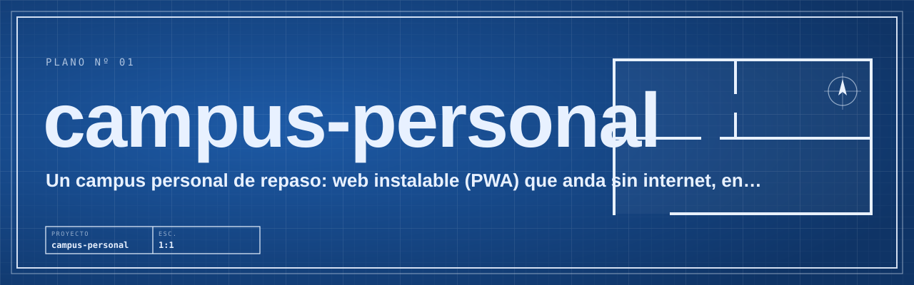

# campus-personal

Un campus personal de repaso: web instalable (PWA) que anda sin internet, en PC y celular, con 6 áreas (análisis de datos, arquitecturas y microservicios, servidores, matemática y física aplicadas, probabilidad y estadística, soporte técnico). Cada tema va de un caso real a la intuición en criollo (con gráficos y simuladores) y después a lo formal, y trae práctica: tarjetas de repaso espaciado, ejercicios que se corrigen solos, casos de guardia y problemas para hacer por cuenta propia.

## Cómo correrlo

- Preparar: `npm ci`
- Probar: `npm run build`

## Más

- [Qué es y para quién](docs/NORTE.md)
- [Mapa del proyecto](docs/MAPA.md)
- [Índice de la documentación](docs/README.md)
<!-- kit:portada 4be40c27c292 -->
