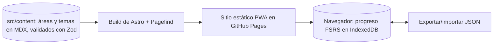

# MAPA — campus-personal

> Cómo se conecta, en una pantalla (tope 5.000 bytes). La arquitectura a fondo va a `referencia/ARCHITECTURE.md`; acá se apunta.

## Por dentro

## Con otras apps
Ninguna. No hay backend ni servicios externos; solo GitHub Pages sirve los archivos.
