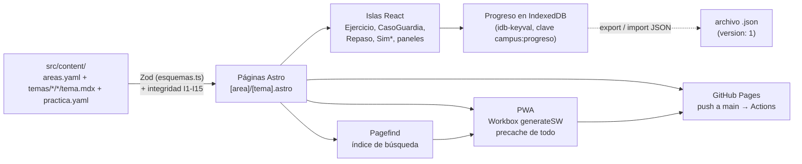
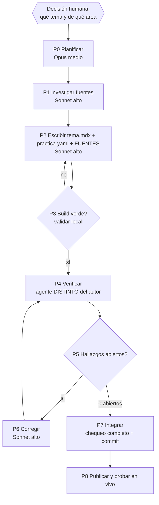
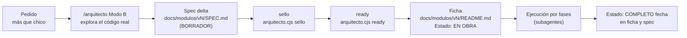
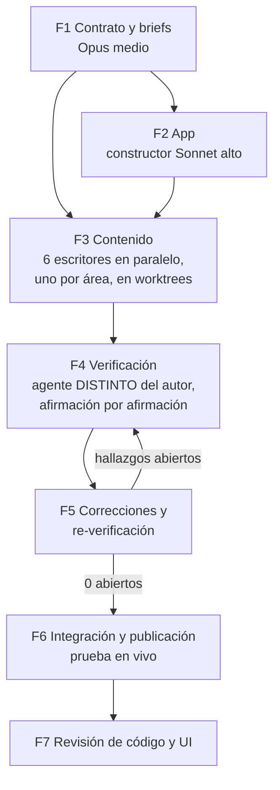

# Guía del proyecto — campus-personal

> Para dos lectores: vos dentro de unos meses (qué hay y cómo se toca) y una sesión futura de Claude que tenga que sumar o actualizar contenido. Todo lo de acá salió del repo; las rutas y los comandos están verificados. Si el repo dice otra cosa, manda el repo. Detalle fino: los documentos de `docs/modulos/v1/diseno/` (se nombran donde corresponde, no se copian).

## Índice

1. [Resumen](#1-resumen)
2. [Cómo está hecho](#2-cómo-está-hecho)
3. [Cómo se carga un tema nuevo (procedimiento)](#3-cómo-se-carga-un-tema-nuevo-procedimiento)
4. [Cómo se arma un módulo nuevo (v2 en adelante)](#4-cómo-se-arma-un-módulo-nuevo-v2-en-adelante)
5. [Metodología con la que se hizo](#5-metodología-con-la-que-se-hizo)
6. [Operación](#6-operación)
7. [Hacia una skill de módulos](#7-hacia-una-skill-de-módulos)

---

## 1. Resumen

**Qué es.** Un campus personal de repaso para dos carreras de la UNLaM (Ingeniería en Informática y Licenciatura en Gestión de Tecnología): una PWA estática, instalable, que anda sin internet, en PC y celular, **sin login** (el progreso vive en el navegador y se pasa entre dispositivos exportando e importando un JSON). Solo en español.

**Para qué.** Lo cursado se olvida, los apuntes están desparramados y la teoría llega sin aplicación. Cada tema va de un **caso real** a la **intuición** (con gráfico o simulador), después a lo **formal**, y cierra con **práctica** y **fuentes**. Un repaso espaciado trae cada concepto antes de que se olvide. Qué es y qué no es: `docs/NORTE.md`.

**En vivo:** https://jrobilara.github.io/campus-personal/ — repo público `jrobilara/campus-personal`, rama `main`.

**Qué hay (contado con un script sobre `src/content/temas`, sin el tema de ejemplo):**

| Cosa | Cantidad |
|---|---|
| Áreas | 6 (4 temas cada una) |
| Temas | 24 |
| Tarjetas de repaso | 284 |
| Ejercicios autocorregibles | 131 |
| Problemas recomendados | 61 |
| Casos de guardia | 20 |
| Simuladores (componentes) | 12 |
| Usos de simuladores en los temas | 42 |
| Fuentes citadas (`verMas: false`) | 150 (45 libro, 90 doc-oficial, 12 artículo, 8 curso-abierto, más "para ver más": 6 blog, 3 video) |
| Fuentes "para ver más" | 14 |
| Informes de verificación | 24 (uno por tema) en `docs/modulos/v1/verificacion/` |

Las áreas: análisis de datos, arquitecturas y microservicios, servidores, matemática y física aplicadas, probabilidad y estadística, soporte técnico (`src/content/areas.yaml`).

---

## 2. Cómo está hecho

### 2.1 Stack (versiones fijadas en `package.json`, nunca `latest`)

| Pieza | Versión | Para qué |
|---|---|---|
| Astro | 7.4.11 | Sitio estático, una página por tema, content collections |
| @astrojs/mdx + @astrojs/react | 8.1.5 / 7.1.8 | Lecciones en MDX; islas de React solo donde hace falta interacción |
| React | 19.3.1 | Islas: repaso, ejercicios, simuladores, paneles |
| Zod (el de `astro/zod`) | — | Valida frontmatter y práctica; el build rompe con archivo y campo |
| remark-math + rehype-katex / katex | 6.0.0 / 7.0.1 / 0.16.47 | Fórmulas |
| ts-fsrs | 6.0.0 | Repaso espaciado (FSRS) |
| idb-keyval | 6.3.0 | Progreso en IndexedDB |
| Mafs + Observable Plot + motion | 0.21.0 / 0.6.19 / 14.12.0 | Gráficos, simuladores y animaciones |
| Pagefind (+ astro-pagefind) | 1.6.0 / 2.0.1 | Buscador que funciona offline |
| @vite-pwa/astro | 2.0.2 | PWA: manifest y service worker (Workbox `generateSW`) |
| Vitest / Playwright | 5.1.0 / 1.65.0 | Tests unitarios y de navegador |

**Por qué este stack:** sitio estático gratis (GitHub Pages), anda offline, Astro valida el contenido y solo carga JavaScript donde hay interactividad. Sin backend ni Python: no hay cálculo del lado del servidor. Las trampas del stack (Astro 7 sin remark por defecto, ts-fsrs 6 con API nueva, el export nombrado de @vite-pwa/astro) están en `docs/modulos/v1/investigacion/stack-verificado.md`. **Node 24** (`.nvmrc`): esta PC trae Node 25, que Astro no soporta, así que `source ~/.nvm/nvm.sh && nvm use 24` antes de correr nada.

### 2.2 Arquitectura



Cómo se lee: los archivos de `src/content/` son la única fuente de verdad (áreas y temas salen de ahí, nunca están escritos en el código de las pantallas). Astro los carga como *content collections* (`src/content.config.ts`: `areas`, `temas`, `practicas`), Zod valida cada archivo y `src/contenido/integridad.ts` valida lo que cruza archivos. `cargarCampus()` (`src/contenido/campus.ts`) junta todo; si hay un error, el build se corta con el archivo y el campo. La página del tema dibuja práctica y fuentes a partir de `practica.yaml` y del frontmatter, así el orden de las 5 partes está forzado por construcción. El `astro.config.mjs` pone Pagefind antes de la PWA a propósito: el índice tiene que existir cuando se arma el precache.

### 2.3 Mapa de `src/`

| Carpeta | Qué tiene |
|---|---|
| `components/` | `PaginaTema.astro`, `CurvaOlvido.astro`, `Icono.astro` y `mdx/` (los componentes que llegan inyectados al MDX: `CasoReal`, `Intuicion`, `Formal`, `Analogia`, `Nota`, `Ojo`, `Cita`, `Formula`, `Profundizar` y un envoltorio `.astro` por simulador, más `SimMarco`) |
| `contenido/` | `esquemas.ts` (Zod), `integridad.ts` (reglas I1-I15, función pura), `campus.ts` (`cargarCampus()`) |
| `content/` | El contenido: `areas.yaml` y `temas/<area>/<slug>/{tema.mdx,practica.yaml}` (más `temas/ejemplo/`) |
| `islas/` | Islas React de las pantallas: `Repaso`, `Ejercicio`, `CasoGuardia`, `Buscador`, `PanelProgreso`, `PanelAjustes`, `ParaHoy`, `DominioArea`, `AvanceTema`, `ContadorHoy` |
| `layouts/` | `Base.astro` (layout común, menú, tema claro/oscuro) |
| `lib/` | `correccion.ts` (corrige ejercicios numéricos), `errores.ts`, `katex-render.ts`, `plot.tsx`, `rehype-sin-katex-error.mjs` y `rehype-katex-sin-indice.mjs` (plugins), `tema.ts`, `texto-corto.ts`, `url.ts` |
| `pages/` | `index`, `[area]/index`, `[area]/[tema]`, `repaso/`, `progreso/`, `buscar/`, `ajustes/`, `ejemplo/` (solo dev o `CAMPUS_INCLUIR_EJEMPLO=1`), `catalogo.json.ts`, `404.astro` |
| `progreso/` | `store.ts` (lectura/escritura atómica y suscripción), `esquema.ts` (Zod de `ProgresoV1`), `fsrs.ts`, `repaso.ts`, `importar.ts`, `metricas.ts`, `fechas.ts`, `ajustes.ts`, `hooks.ts`, `uso.ts`, `catalogo-cliente.ts` |
| `simuladores/` | Los 12 `Sim*.tsx`, sus carpetas de cálculo puro, `props.ts` (esquemas Zod de las props y catálogo de nombres), `mafs-comun.tsx`, `ui.tsx`, `formato.ts`, `azar.ts`, `presets/` |
| `styles/` | `tokens.css`, `base.css`, `practica.css`, `sim.css` |

### 2.4 Cómo funciona el repaso espaciado (FSRS)

La memoria se olvida siguiendo una curva: justo después de estudiar te acordás de todo, y con los días la probabilidad de acordarte (*retrievability*, R) baja. FSRS modela esa curva con un número por tarjeta, la **estabilidad** (S): los días que tarda R en caer a 0,9. En la app, la curva es `R(t) = (1 + t / (9·S))^-1` (la dibuja `src/components/CurvaOlvido.astro` con las cuentas reales).

La idea: **repasás justo cuando R bajó a 0,9**. Si te acordás, la estabilidad sube y el próximo repaso llega más tarde (1, 2, 5, 12, 27 días en el dibujo de la portada); si te olvidás, vuelve a intervalos cortos. Calificás cada tarjeta con 1 (Again), 2 (Hard), 3 (Good) o 4 (Easy) y `ts-fsrs` calcula la próxima fecha.

Configuración real (`src/progreso/fsrs.ts`): modelo FSRS-7, retención deseada 0,9, sin *fuzz* (para que los tests con reloj fijo sean deterministas), pasos de aprendizaje 1 min y 10 min, reaprendizaje 10 min, intervalo máximo 36.500 días. Tope de tarjetas nuevas por día: 10 (ajustable en `/ajustes/`). Trampa conocida: un card que pasó por `JSON.parse` falla en `review()` hasta que se reconvierten `dueAt` y `lastReviewAt` a `Date` (lo hacen `serializarCard`/`deserializarCard`).

### 2.5 Progreso: formato, versionado, export e import

Detalle completo: `docs/modulos/v1/diseno/PROGRESO-JSON.md`. Resumen:

- **Dónde:** IndexedDB (idb-keyval), clave `campus:progreso`. Ajustes (tema, nuevas por día) en `localStorage`, clave `campus:ajustes`, y **no viajan** en el export.
- **Forma (`ProgresoV1`, validada con Zod en `src/progreso/esquema.ts`):** `app: "campus-personal"`, `version: 1`, `exportadoEn`, `fsrs`, `tarjetas` (estado FSRS por id global), `revlog` (historial de repasos), `ejercicios`, `casos`, `diasDeEstudio`. Los ids globales son `<area>/<slug>#<idLocal>` (por eso un id publicado no se renombra nunca).
- **Escritura atómica:** toda escritura pasa por `update` de idb-keyval (transacción), así dos pestañas no se pisan. Si lo guardado está dañado, se hace una copia aparte (`campus:progreso-danado`) antes de escribir.
- **Exportar** (`exportarProgreso`): descarga `campus-progreso-<día>.json`.
- **Importar** (`analizarImport` → `confirmarImport`): valida contra el esquema; si es inválido, **avisa y no toca el progreso actual**. Antes de confirmar guarda una copia (`campus:progreso-antes-de-importar`) para poder deshacer. Archivos de una versión distinta pasan por `MIGRACIONES` (hoy vacío: solo existe v1; un archivo de versión desconocida se rechaza con mensaje).
- **Cambiar el formato** exige subir `version`, escribir `migrarDeV<n>` y actualizar `PROGRESO-JSON.md`.

### 2.6 Integridad del contenido (reglas I1-I15)

Zod valida cada archivo solo (campos, tipos, mínimos como `tarjetas.min(6)`). Lo que cruza archivos lo valida `verificarIntegridad` en `src/contenido/integridad.ts`:

| Regla | Verifica | Severidad |
|---|---|---|
| I1 | Cada carpeta de tema tiene `tema.mdx` y `practica.yaml` | error |
| I2 | `area` existe en `areas.yaml` y coincide con la carpeta (el ejemplo vive en `ejemplo/` con `ejemplo: true`) | error |
| I3 | `orden` no se repite dentro de un área | error |
| I4 | Los `prerrequisitos` existen y no son el propio tema | aviso; error en estricto |
| I5 | Toda `fuente` referenciada en `practica.yaml` existe en el frontmatter (y la de un problema no puede ser video ni blog) | error |
| I6 | Forma del cuerpo: sin `import`/`export`, exactamente un `<CasoReal>`, un `<Intuicion>` y un `<Formal>` en ese orden, sin encabezados `#`/`##` | error |
| I7 | Si el área tiene `exigeCasoDeGuardia: true`, hay ≥1 caso | error |
| I8 | `<Intuicion>` tiene ≥1 simulador y ≥1 `<Analogia>` | error |
| I9 | Todo `<Sim…>` es del catálogo (`NOMBRES_SIMULADORES`) | error |
| I10 | Todo `<Cita f="x">` apunta a una fuente con `verMas: false` | error |
| I11 | Toda fuente con `verMas: false` se usa; `<Formal>` tiene ≥1 `<Cita>` | error |
| I12 | (estricto) cada área tiene ≥3 temas reales | error en estricto |
| I13 | (estricto) cada área suma ≥2 usos de simulador | error en estricto |
| I14 | El tema de ejemplo no cuenta ni aparece en portada, repaso, progreso ni buscador | regla de la app |
| I15 | El `id` de un área no puede ser una ruta reservada (`ejemplo`, `repaso`, `progreso`, `buscar`, `ajustes`, `pagefind`, `catalogo`) | error |

Dos variables de entorno cambian el comportamiento:

- `CAMPUS_ESTRICTO=1`: prende I12/I13 y vuelve error I4. Lo prende el workflow de GitHub Actions; en local está apagado para poder construir de a poco.
- `CAMPUS_INCLUIR_EJEMPLO=1`: suma el tema de ejemplo (`ejemplo/media-y-mediana`) a portada, área, repaso, progreso y catálogo. Solo para los tests e2e (Playwright la usa al construir).

Un LaTeX inválido también rompe el build: rehype-katex ignora `throwOnError` y deja un `<span class="katex-error">`, así que `src/lib/rehype-sin-katex-error.mjs` lo detecta y tira el error.

### 2.7 Tests y CI

- **Vitest** (`npm test`, con `TZ=America/Argentina/Buenos_Aires`; 19 archivos, 381 tests en `tests/`): esquemas, las 15 reglas de integridad, corrección de ejercicios, FSRS con reloj fijo, store/import/export del progreso, y el cálculo de cada simulador (`tests/sim-*.test.ts`).
- **Playwright** (`npm run e2e`; 21 archivos en `e2e/`, 174 tests, Chromium): navegación, búsqueda, repaso, progreso, ajustes, práctica, offline, subpath (sin 404 de recursos ni errores de consola), móvil (390 px) y un spec por simulador. El `playwright.config.ts` arma un build con `CAMPUS_INCLUIR_EJEMPLO=1` y lo sirve con `astro preview` en el puerto 4321.
- **Chequeo completo (el que se corre antes de cada commit grande):**

  ```bash
  source ~/.nvm/nvm.sh && nvm use 24
  npx astro check && CAMPUS_ESTRICTO=1 npm run build && npx vitest run && npx playwright test
  ```

  **Un proceso pesado por vez**: build y Playwright juntos se quedan sin memoria (exit 137).
- **Candado documental:** `node .claude/scripts/estructura.cjs todo` tiene que salir 0 (lo exigen los githooks; nunca `--no-verify`).
- **CI/deploy** (`.github/workflows/deploy.yml`): en cada push a `main` corre `test` (`npm ci`, `astro check`, `npm run build`, `npm test`, Playwright), después `build` (withastro/action) y `deploy` a GitHub Pages. El workflow trae `CAMPUS_ESTRICTO=1`.

---

## 3. Cómo se carga un tema nuevo (procedimiento)

Este procedimiento es el que se usó en v1 para los 24 temas, escrito como pasos ejecutables. Cada paso dice rol, modelo y esfuerzo, brief, entradas, salidas, comando que decide si pasó, y criterio de salida. Convención de modelos del proyecto: **Opus con esfuerzo medio para planificar, Sonnet con esfuerzo alto para ejecutar**. El verificador es **siempre un agente distinto del autor**.

Briefs que existen (en `docs/modulos/v1/diseno/`): `BRIEF-ESCRITORES.md` (encargo del escritor, parametrizado por área en su §7), `BRIEF-CONSTRUCTOR.md` (solo para cambios de la app), `CONTRATO-CONTENIDO.md` (forma exacta de los archivos), `GUIA-ESTILO.md` (la voz y los largos), `SIMULADORES.md` (catálogo de simuladores y props). Plantilla viva: el tema `src/content/temas/ejemplo/media-y-mediana/` (su `tema.mdx` y `practica.yaml`) y `CONTRATO-CONTENIDO.md` §9.



### P0 — Planificar el tema
- **Rol / modelo:** planificador, Opus esfuerzo medio.
- **Entradas:** el pedido (tema, área), `docs/modulos/v1/SPEC.md` (sección "Temas de v1"), `docs/modulos/v1/investigacion/unlam-planes.md` (materias UNLaM), `SIMULADORES.md` §3 (qué simulador encaja).
- **Salidas:** slug (kebab-case, sin tildes, ≤40; regex `^[a-z0-9]+(-[a-z0-9]+)*$`), `orden` libre en el área, materias de anclaje (`carrera` + código de 4 dígitos), prerrequisitos, simulador(es) elegido(s), lista de conceptos que van a ser tarjetas/ejercicios, y si el área exige caso de guardia.
- **Brief:** `CONTRATO-CONTENIDO.md` §1-§2 y `SIMULADORES.md`.
- **Chequeo:** el slug no existe: `ls src/content/temas/<area>/`; el `orden` no se repite (regla I3).
- **Salida OK cuando:** el plan nombra slug, orden, materias, simuladores y el esqueleto de las 5 partes.

### P1 — Investigar fuentes
- **Rol / modelo:** investigador de fuentes, Sonnet esfuerzo alto (con acceso a la web; el agente `investigador` de `.claude/agents/` es para datos puntuales).
- **Entradas:** el plan de P0 y la política de fuentes (§5.4 de esta guía; resumen en `BRIEF-ESCRITORES.md` §4).
- **Salidas:** fuentes candidatas con autor, título, edición/año, ubicación exacta (capítulo, sección o URL con ancla), leídas de verdad (abrir la página o el PDF, no recordarlas).
- **Regla:** nada se cita de memoria; si no se pudo abrir la fuente, no se usa.
- **Salida OK cuando:** ≥2 fuentes que respaldan datos (`libro`, `doc-oficial`, `curso-abierto`, `articulo`), cada una con ubicación verificada.

### P2 — Escribir el tema
- **Rol / modelo:** escritor, Sonnet esfuerzo alto (en v1, uno por área, cada uno en su worktree).
- **Brief:** `BRIEF-ESCRITORES.md` (leer en el orden de su §1), con `CONTRATO-CONTENIDO.md`, `GUIA-ESTILO.md`, `SIMULADORES.md`.
- **Entradas:** salidas de P0 y P1.
- **Salidas (solo estas rutas):**
  - `src/content/temas/<area>/<slug>/tema.mdx`: frontmatter + las tres secciones.
  - `src/content/temas/<area>/<slug>/practica.yaml`: tarjetas, ejercicios, casos, problemas.
  - `docs/modulos/<modulo>/fuentes/FUENTES-<area>.md`: una fila por afirmación clave (afirmación, dónde está, id de fuente, ubicación exacta, cómo la verificó), más "números inventados para ejemplos" y "pedidos al director".
- **Reglas del contenido (las hace cumplir el build):**
  - Estructura del cuerpo: `<CasoReal titulo="…">` → `<Intuicion>` (≥1 `<Analogia>` y ≥1 simulador) → `<Formal>` (≥1 `<Cita>`). La práctica y las fuentes las dibuja la página. Sin `import`, sin `#`/`##`, línea en blanco después de cada etiqueta de apertura y antes de cada cierre.
  - Ids con prefijo: `t-` tarjeta, `e-` ejercicio, `c-` caso, `p-` problema, kebab-case, que describan la idea (`t-mediana-robusta`, no `t-3`). Un id publicado no se renombra nunca.
  - Mínimos: ≥6 tarjetas, ≥3 ejercicios (de ≥2 tipos entre `numerico`, `opcion-multiple`, `verdadero-falso`), ≥2 problemas recomendados, ≥1 caso de guardia si el área tiene `exigeCasoDeGuardia: true` (hoy: arquitecturas, servidores, soporte).
  - Fuentes en el frontmatter (`fuentes:`, ≥2 con `verMas: false`, todas usadas): `libro` (`edicion` y `ubicacion` obligatorias), `doc-oficial` (`url`), `curso-abierto` (`url`), `articulo` (`edicion`: revista, volumen y año). `blog` y `video` solo con `verMas: true`: no respaldan ningún dato.
  - Cada afirmación lleva cita (`<Cita f="id-fuente" loc="sección" />`); paráfrasis propia, nunca texto copiado; criollo rioplatense con el término técnico en inglés entre paréntesis.
  - Para un simulador existente: `<SimXxx consigna="Qué tiene que probar el lector" …props />`. La `consigna` es obligatoria (≤240 caracteres); las demás props de cada uno están en `SIMULADORES.md` §2 y se validan con Zod en el build.
- **Chequeo (P3):** ver abajo.

### P3 — Validar localmente (puerta del escritor)
- **Comandos exactos:**

  ```bash
  source ~/.nvm/nvm.sh && nvm use 24
  npm ci                              # la primera vez en el worktree
  npm run build                       # esquemas + reglas cruzadas + props de simuladores
  CAMPUS_ESTRICTO=1 npm run build     # además I12/I13 y prerrequisitos (modo del CI)
  npm run dev                         # mirarlo en http://localhost:4321/campus-personal/<area>/<slug>/
  ```
- **Pasó si:** ambos builds salen con código 0. Los errores dicen archivo, campo y regla (`[contenido] src/content/temas/… → practica.yaml → tarjetas.3.dorso: …`). Un prerrequisito a un tema de otra área que todavía no existe en tu worktree falla en estricto: es esperable, se anota.
- **Commit del escritor:** solo sus rutas (`F3 <area>: …`).

### P4 — Verificar (agente distinto del autor)
- **Rol / modelo:** verificador, Sonnet esfuerzo alto, **otra sesión y otro contexto que el escritor**. No lee la intención del autor: lee el tema y la fuente.
- **Entradas:** `tema.mdx`, `practica.yaml`, `FUENTES-<area>.md` (como mapa, no como prueba) y las fuentes originales.
- **Método:** afirmación por afirmación, abrir la fuente en la ubicación citada y comprobar que lo dice. Recalcular todas las respuestas numéricas de los ejercicios sin mirar las del autor (en v1, con Python). Contrastar la matriz/valores con `SIMULADORES.md`. Chequear que no haya frases copiadas.
- **Salida:** `docs/modulos/<modulo>/verificacion/<slug>.md` con el formato real de v1:

  ```markdown
  # Verificación F4: <título del tema>

  - **Tema:** `<area>/<slug>`
  - **Fecha:** AAAA-MM-DD
  - **Verificador:** F4 (agente distinto del autor)
  - **Veredicto:** APROBADO | OBSERVADO | RECHAZADO (detalle de rondas)

  **Método.** Qué abrió, cómo recalculó, qué contrastó.

  ## Afirmaciones revisadas
  | # | Afirmación | Fuente | Ubicación | Resultado | Nota |
  |---|---|---|---|---|---|
  | 1 | … | id-fuente | sección exacta | ✅ / ⚠️ / ❌ | por qué; "Ver H1" si hay hallazgo |

  **Estado del tema: OBSERVADO** (N abiertos).

  ## Hallazgos abiertos
  **H1: título corto.** Archivo, sección, qué dice vs qué dice la fuente, corrección propuesta.

  ## Re-verificación / Cierre de ronda N (AAAA-MM-DD, `git diff <desde>..<hasta>`)
  | Hallazgo | Estado | Evidencia |
  | H1 | CERRADO (<commit>) | qué cambió y qué dice ahora la fuente |
  Hallazgos nuevos: ninguno.

  **Estado del tema: APROBADO** (0 abiertos).
  ```
- **Pasó si:** el informe existe con una fila por afirmación y estado final.

### P5 — Decidir
- **Rol:** integrador (la sesión que dirige).
- **Entrada:** el informe de P4.
- **Regla:** cualquier ⚠️/❌ es un hallazgo abierto. Si hay abiertos, pasa a P6. Si el estado dice **APROBADO (0 abiertos)**, pasa a P7.
- **Comando de control:** `grep -n "Estado del tema" docs/modulos/<modulo>/verificacion/<slug>.md` (la última línea tiene que decir APROBADO con 0 abiertos).

### P6 — Corregir y re-verificar
- **Rol / modelo:** corrector, Sonnet esfuerzo alto (puede ser el autor), y **P4 se repite con un verificador distinto del corrector** sobre el `git diff` de la corrección. Cada ronda agrega su sección "Cierre de ronda N" al mismo informe. En v1 hubo hasta 3 rondas (ver `verificacion/prioridad-y-sla.md`).
- **Chequeo del corrector:** P3 otra vez (ambos builds).
- **Criterio de salida:** **cero hallazgos abiertos**.

### P7 — Integrar
- **Rol:** integrador (la sesión directora), no el escritor.
- **Entradas:** rama/worktree del escritor ya aprobada.
- **Pasos:** merge a `main`; luego el chequeo completo y el candado:

  ```bash
  source ~/.nvm/nvm.sh && nvm use 24
  npx astro check && CAMPUS_ESTRICTO=1 npm run build && npx vitest run && npx playwright test
  node .claude/scripts/estructura.cjs todo
  ```
- **Pasó si:** todo sale 0. Un solo proceso pesado a la vez. Si un test e2e asumía una cantidad de temas o tarjetas, se ajusta (pasó con los tests de repaso al llegar el contenido real: el tope diario es de 10 nuevas).
- **Commit:** en español, con la línea `Co-Authored-By` que pide el repo; nunca `--no-verify`.

### P8 — Publicar y probar en vivo
- `git push origin main`; seguir el workflow (ver §6) hasta verde (máximo 3 intentos); abrir el sitio publicado y probar el tema nuevo: carga, simulador, una tarjeta en `/repaso/`, y la búsqueda de una palabra del tema.
- **Salida OK cuando:** workflow en verde y el tema se ve y se busca en `https://jrobilara.github.io/campus-personal/`.

### 3.1 Cómo se agrega un área nueva
1. **Decisión humana:** nombre y temas (el SPEC de v1 dice 6 áreas; una séptima es un cambio de alcance, va por Arquitecto, §4).
2. Sumar un bloque a `src/content/areas.yaml` con `id`, `nombre`, `orden`, `color`, `colorOscuro`, `icono`, `descripcion` y `exigeCasoDeGuardia` (esquema `esquemaArea` en `src/contenido/esquemas.ts`). El `id` no puede ser una ruta reservada (I15).
3. Si usa un `icono` nuevo, agregarlo en `src/components/Icono.astro`.
4. Crear `src/content/temas/<id>/` y cargar ≥3 temas con el procedimiento de arriba (en estricto, I12/I13 exigen ≥3 temas reales y ≥2 usos de simulador por área).
5. Ninguna pantalla se toca: portada, página de área, repaso, progreso y buscador salen de las colecciones.
6. **Tests que mirar:** `tests/esquemas.test.ts` e `tests/integridad.test.ts` (si cambia una regla o el esquema), y los e2e que cuentan áreas (`areasDelContrato` en `e2e/util.ts` lee `areas.yaml`; revisar los que asumen "6").

### 3.2 Cómo se agrega un simulador nuevo
Hoy son 12 (`SIMULADORES.md`). Un simulador nuevo es un cambio de la app (no de contenido): pasa por un módulo con spec (§4) y el brief `BRIEF-CONSTRUCTOR.md`. Archivos a tocar:

1. `src/simuladores/<carpeta>/calculo.ts`: la lógica pura (lo que se testea en Vitest).
2. `src/simuladores/Sim<Nombre>.tsx`: la isla React.
3. `src/simuladores/props.ts`: el esquema Zod de props (`propsSimNuevo`, con `consigna` obligatoria) y su entrada en `ESQUEMAS_SIMULADORES` (de ahí sale `NOMBRES_SIMULADORES`, el catálogo que usa la regla I9).
4. `src/components/mdx/Sim<Nombre>.astro`: el envoltorio (copiar `SimBayes.astro`: valida props con `validarPropsSimulador` y monta la isla con `client:visible` dentro de `SimMarco`).
5. `src/components/mdx/index.ts`: importarlo y registrarlo en el mapa de componentes.
6. `src/pages/ejemplo/[pagina].astro`: agregar una instancia de prueba.
7. `docs/modulos/v1/diseno/SIMULADORES.md`: documentarlo (props, qué enseña).
8. **Tests:** `tests/sim-<nombre>.test.ts` (cálculo, Vitest) y `e2e/sim-<nombre>.spec.ts` (interacción, y que no desborde a 390 px; hay helpers en `e2e/sim-util-a.ts` y `e2e/sim-util-e.ts`).
9. Chequeo completo (§2.7).

---

## 4. Cómo se arma un módulo nuevo (v2 en adelante)

Una feature más que chica sobre la app que ya anda (lo que no es "chico, lo hago acá" según `CLAUDE.md`) va por el **Arquitecto, Modo B** (`/arquitecto`):



1. **Modo B:** el Arquitecto explora el código real, entrevista lo que haga falta y escribe un spec delta (`docs/modulos/<v>/SPEC.md`, `Estado: BORRADOR`) con criterios verificables.
2. **Sellar y marcar READY, solo con los scripts** (`node ~/.claude/skills/arquitecto/scripts/arquitecto.cjs`): `sello <spec>` calcula el hash y escribe la línea del sello; `tope <spec>` mide el tamaño; `ready <spec>` cambia BORRADOR por READY. El sello y el READY **nunca se escriben a mano**. `ready --pendientes` (parado en la raíz) lista los módulos con spec sin sello válido o tocado después del sello. El spec READY no se edita; un cambio aprobado va como `SPEC-2.md` en el mismo módulo.
3. **Ficha del módulo** `docs/modulos/<v>/README.md` con `Estado: EN OBRA`, `director`, `Próximo paso` y la lista de tareas (tope 5.000 bytes mientras está en obra).
4. **Ejecución por fases** con subagentes (§5). Al terminar: `Estado: COMPLETO <fecha>` en la ficha y en el spec, y la carpeta se queda en `docs/modulos/`.
5. Pendientes y decisiones del dueño van a `docs/TODO.md` (única fuente de pendientes).

**Ítems de v2 que ya están en `docs/TODO.md`:** mapa de conexiones entre temas (grafo) · recordatorio diario de repaso (notificación) · el dueño deja libros nuevos en una carpeta (Kleppmann, Newman, ITIL 4 Foundation, Strang/Grossman, Rosen, Ross/Walpole) para reforzar citas · simuladores de reintentos con jitter, partición de red (CAP) y peeking en A/B (tests A/A) · una skill del repo para crear/actualizar módulos (§7). Y una decisión pendiente del usuario: el precache del HTML (§6.4). Esta guía no implementa ninguno.

---

## 5. Metodología con la que se hizo

### 5.1 Del pedido al sistema
1. **Entrevista** con el Arquitecto (Modo A) → **SPEC-0** en `docs/modulos/v1/SPEC.md` con 8 criterios de aceptación verificables, **sellado y READY** por script.
2. **Montaje** del sistema con el kit (vibe-kit 3.0.0-rc.6, `.claude/kit.md`): candado documental (`.claude/scripts/estructura.cjs`), githooks, ficha de módulo, skills de sesión (`/inicio`, `/cierre`, `/estado`, `/director`, `/obrero`, `/tramo`) y agentes (`.claude/agents/`). **Nunca `--no-verify`.**
3. **Sesión "director":** no escribe código ni contenido; lanza subagentes y verifica lo que devuelven. Patrón de modelos: **Opus esfuerzo medio planifica, Sonnet esfuerzo alto ejecuta**.

### 5.2 Fases



| Fase | Qué se hizo | Resultado en el repo |
|---|---|---|
| F1 | Contrato de contenido, guía de estilo, plan de simuladores, formato del progreso y los briefs | `docs/modulos/v1/diseno/` |
| F2 | La app: esquemas, páginas, islas, 12 simuladores, progreso, buscador, PWA, tests y CI, por hitos 0 a 5 | `src/`, `tests/`, `e2e/`, `.github/workflows/deploy.yml` |
| F3 | Seis escritores en paralelo (uno por área), cada uno en un worktree `contenido/<area>`, más su `FUENTES-<area>.md` | `src/content/temas/`, `docs/modulos/v1/fuentes/` |
| F4 | Un verificador distinto del autor, afirmación por afirmación contra la fuente | `docs/modulos/v1/verificacion/*.md` (24) |
| F5 | Correcciones y re-verificación hasta cero hallazgos abiertos (hasta 3 rondas en un tema) | cierres de ronda dentro de cada informe |
| F6 | Integración (merge de las 6 ramas), repo público, Pages, prueba en el sitio vivo | https://jrobilara.github.io/campus-personal/ |
| F7 | Revisión de código y de UI (progreso, repaso, buscador, accesibilidad) | commits `26ffebe`..`f6be9e8` |

### 5.3 Reglas de oro
- **El verificador no es el autor.** Un autor que se verifica a sí mismo confirma lo que ya cree.
- **Cero hallazgos abiertos** para dar un tema por terminado.
- **El contenido lo valida el build**, no la buena voluntad: mínimos, ids, citas y forma salen de Zod e `integridad.ts`.
- **Un proceso pesado por vez** en esta máquina.

### 5.4 Política de fuentes
El conocimiento siempre gratis. **Fuentes abiertas primero** (MIT OpenCourseWare, documentación oficial, RFC, NIST, libros de Google SRE publicados online). **Libros pagos solo como refuerzo**, citados con edición y capítulo, y solo si se pudo consultar. **Nada citado de memoria**: cada ubicación se abre y se lee. **Videos y blogs solo como "para ver más"**, nunca respaldan un dato. Paráfrasis propia, nunca copiado.

### 5.5 Lecciones aprendidas (casos reales de este proyecto)
- **Un artículo no es documentación oficial.** Fowler, microservices.io, Brewer, Gilbert-Lynch, Shannon y Johari se retiparon a `articulo` (commit `0ca77cd`), y los datos bibliográficos se contrastaron con Crossref, Fowler y arXiv (`4526bf8`). En el tema de CAP, la verificación encontró que una cita de Brewer apuntaba a una sección distinta a la que decía la afirmación y que la ficha de Gilbert-Lynch no traía la edición exacta (IEEE Computer 45(2), feb. 2012): ambas cosas se corrigieron (`verificacion/resiliencia-y-cap.md`).
- **El `404.html` rompía el service worker, y solo en Pages** (`8907c90`). Workbox lo precacheaba como `404/`, una URL que en GitHub Pages responde 404: el precache fallaba y el service worker nunca se instalaba. En local no pasaba. Solución: `globIgnores: ['404.html', …]`. Por eso la prueba en el sitio vivo no es opcional.
- **El buscador no andaba offline** (`26ffebe`). Faltaban en el precache los `.wasm` y el filtro de Pagefind, y `pagefind.js` pide `pagefind-entry.json?ts=<reloj>`: sin `ignoreURLParametersMatching: [/^ts$/]` el precache no lo reconocía.
- **Memoria:** correr el build y Playwright juntos (o dos Playwright) mata el proceso por falta de memoria (exit 137). Un proceso pesado por vez; si da 137, esperar y reintentar.
- **rehype-katex ignora `throwOnError`:** deja un `<span class="katex-error">` y el build pasa con una fórmula rota. `src/lib/rehype-sin-katex-error.mjs` lo convierte en error de build, con test (`tests/rehype-katex-error.test.ts`).
- **Overflow a 390 px:** los temas se desbordaban en pantallas angostas (`9872b27`) y después la etiqueta del eje de un simulador de monitoreo se cortaba (`3f71d45`). Los e2e `movil.spec.ts` y los de cada simulador miden el ancho a 390 px.
- **El sello se rompe si se edita el spec** después de sellarlo: un cambio de ruta en el criterio 8 (F6b) dejó a `ready --pendientes` marcando "cambió después del sello"; se resuelve cerrando el módulo (`COMPLETO`), no editando a mano el sello.

---

## 6. Operación

### 6.1 Comandos del día a día
Siempre antes: `source ~/.nvm/nvm.sh && nvm use 24`.

| Qué | Comando |
|---|---|
| Instalar | `npm ci` |
| Desarrollo | `npm run dev` (http://localhost:4321/campus-personal/) |
| Build | `npm run build`; estricto (como el CI): `CAMPUS_ESTRICTO=1 npm run build` |
| Tipos | `npx astro check` (o `npm run check`) |
| Unit | `npm test` o `npx vitest run` |
| E2E | `npx playwright test` (o `npm run e2e`); un archivo: `npx playwright test e2e/practica.spec.ts` |
| Chequeo completo | `npx astro check && CAMPUS_ESTRICTO=1 npm run build && npx vitest run && npx playwright test` |
| Candado | `node .claude/scripts/estructura.cjs todo` (tiene que salir 0) |
| Pendientes de specs | `node ~/.claude/skills/arquitecto/scripts/arquitecto.cjs ready --pendientes` |

### 6.2 Publicar
`git push origin main`. El workflow `Deploy a GitHub Pages` corre solo. Para seguirlo: `gh run list --limit 3` y `gh run watch <id>` (o `gh run view <id> --log-failed` si falla). También se puede lanzar a mano (`workflow_dispatch`). Los commits van en español, terminados con la línea `Co-Authored-By` del repo.

### 6.3 Documentos que se mantienen
`docs/SESSION_HANDOFF.md` (dónde quedamos; lo sobreescribe `/cierre`, tope 5.000 bytes), `docs/TODO.md` (única fuente de pendientes), `docs/CHANGELOG.md` (historia, entrada nueva al tope), la ficha del módulo, `docs/referencia/trampas.md` (lo que costó descubrir). Mapa completo: `CLAUDE.md`.

### 6.4 Decisiones pendientes y límites conocidos
- **Pendiente del usuario (en `docs/TODO.md`):** el precache del HTML. Hoy se precachea todo (~7 MB, ~160 archivos; el HTML pesa ~3,7 MB). Pasarlo a *runtime caching* bajaría a la mitad la primera instalación del service worker, pero se pierde el offline de los temas no visitados.
- **Primera instalación del service worker:** medida en vivo el 2026-11-12 (Chromium headless, primera visita, 160 archivos precacheados): el service worker pasó a controlar la página a los ~43 s. En otra corrida hecha justo después del deploy, a los 60 s todavía iba por 55 de 160 archivos. Es decir: hay que esperar de 40 s a más de 1 min con conexión la primera vez; después, todo anda sin red (búsqueda de "varianza" offline devuelve `variables-y-distribuciones`).
- **Sin sincronización entre dispositivos** (decisión del SPEC-0): se pasa el progreso con exportar/importar.
- **Un id publicado no se renombra:** renombrar una carpeta de tema o un id local rompe el progreso guardado (los ids globales son `<area>/<slug>#<id>`).
- **Solo español y sin login:** decididos en el SPEC-0, no se reabren sin Arquitecto.
- **Los registros de ejercicios y casos de guardia que fallan al guardar** avisan en pantalla (ejercicios desde el cierre de v1); los casos de guardia (`useCaso`) todavía no.

---

## 7. Hacia una skill de módulos

Objetivo futuro (no construido, está en `docs/TODO.md`): una skill del repo que cree o actualice módulos con esta metodología. Esta sección es su insumo.

### 7.1 El pipeline como pasos deterministas

| Paso | Tipo | Qué decide que pasó |
|---|---|---|
| 0. Elegir módulo/temas | **Humano** | Lista de temas aprobada por el dueño |
| 1. Spec delta (Arquitecto Modo B) | **Humano aprueba** | `arquitecto.cjs sello` + `ready` (solo por script) |
| 2. Ficha del módulo | Determinista | `node .claude/scripts/estructura.cjs todo` sale 0 |
| 3. Planificar (P0) | Agente Opus medio | Plan con slug, orden, materias, simuladores |
| 4. Investigar fuentes (P1) | Agente Sonnet alto | Fuentes abiertas con ubicación leída |
| 5. Escribir (P2) en worktree por área | Agente Sonnet alto | `npm run build` y `CAMPUS_ESTRICTO=1 npm run build` en 0 |
| 6. Verificar (P4) | Agente distinto del autor | Informe con una fila por afirmación |
| 7. Corregir (P6) y re-verificar | Bucle | Ningún ⚠️/❌ abierto; "APROBADO (0 abiertos)" |
| 8. Integrar (P7) | Determinista | Chequeo completo + candado en 0 |
| 9. **Publicar** | **Humano autoriza** (hoy está autorizado el push a main con gate verde) | Workflow verde |
| 10. Prueba en vivo (P8) | Determinista (script Playwright contra el sitio) | Portada, tema, búsqueda y offline OK |
| 11. Cierre de docs | Determinista | Ficha COMPLETO, CHANGELOG, HANDOFF, TODO |

### 7.2 Qué se reutiliza tal cual y qué hay que parametrizar

**Reutilizable tal cual** (no mencionan v1 en su lógica): `CONTRATO-CONTENIDO.md` §3-§8 (esquemas, ids, reglas I1-I15, componentes, formatos de práctica), `GUIA-ESTILO.md` (voz, largos, citas, errores que rompen el build), `SIMULADORES.md` §1-§2 (catálogo y props), las partes comunes del `BRIEF-ESCRITORES.md` (§1 qué leer, §3 mínimos, §4 fuentes, §5 validar, §6 formato de `FUENTES-<area>.md`, §8 cómo entregar), el formato del informe de verificación, el tema de ejemplo, y los comandos de chequeo.

**Específico de v1 → parametrizar:**
- `BRIEF-ESCRITORES.md` §7 (las seis áreas, sus slugs fijados y fuentes candidatas): parámetros área, slugs, lista de conceptos y fuentes candidatas.
- Rutas con `modulos/v1/` (SPEC, `fuentes/`, `verificacion/`, `investigacion/unlam-planes.md`): parámetro módulo (`<v>`).
- `BRIEF-CONSTRUCTOR.md` entero: solo vale para construir la app de cero; un módulo de contenido no lo usa. Para features de app se escribe un brief nuevo desde el spec.
- Los mínimos "24 temas / 6 áreas / ≥3 temas por área" son de v1 (SPEC y reglas estrictas I12/I13).
- Las materias UNLaM de anclaje (`unlam-planes.md`) cambian si cambian las carreras.

### 7.3 Dónde viviría en el repo
En `.claude/skills/<nombre>/SKILL.md`. Verificado: esa carpeta ya existe y está versionada (`cierre`, `director`, `estado`, `inicio`, `nucleo`, `obrero`, `tramo`) y el candado (`.claude/hooks/lib/candado.cjs`) la trata como zona de skills, no la prohíbe. Lo que el candado sí exige dentro de `.claude/skills/**`: **cero rutas absolutas, ids de sesión, ramas concretas ni SHAs** (usar `<placeholders>`), y que lo que la skill cite de más de 100 KB esté declarado. Los agentes (`.claude/agents/*.md`, con `model` y `effort` en el frontmatter) son el lugar natural para los roles (investigador, escritor, verificador). Lo que **no** se verificó: crear de verdad una skill nueva y correr el candado con ella, porque el encargo era no construirla; hay que probarlo al hacerla. Una skill nueva también se anota en `.claude/kit.md` según cómo trate el kit las piezas propias, y los cambios de método se registran con `node .claude/scripts/cambios.cjs nuevo …`.

### 7.4 Riesgos a cubrir
- **Verificador igual al autor:** la skill debe lanzar el verificador en un contexto nuevo, sin el borrador de razonamiento del autor, y rechazar un informe cuyo "Verificador" sea el mismo agente. Sin esto, el control no controla nada.
- **Citas de memoria:** el verificador tiene que abrir la fuente en la ubicación citada; una fila sin ubicación o sin "cómo se verificó" no vale. Si una fuente no se puede abrir, se descarta.
- **OOM con builds en paralelo:** seis escritores no pueden correr `npm run build` a la vez. Serializar los builds (uno por vez) o dar a cada worktree su propio caché (`CAMPUS_VITE_CACHE` existe para varios `astro dev`) y limitar la concurrencia; recordar el exit 137.
- **Worktrees por área:** cada escritor toca solo su carpeta de área y su `FUENTES-<area>.md`; el integrador mergea de a una rama y corre el chequeo completo. Antes de borrar un worktree: rama mergeada en `main` y `git status --short` vacío (`git worktree remove`, `git branch -d`, nunca `-D`).
- **Ids que se renombran:** un cambio de id rompe el progreso guardado de quien ya repasó: la skill de actualización no puede renombrar ids publicados.
- **Tests que asumen cantidades** (de temas, de tarjetas): al sumar contenido hay que revisar los e2e que cuentan.
- **Errores sólo visibles en Pages** (como el 404): la prueba en vivo es parte del pipeline, no un extra.
- **Editar un spec sellado:** rompe el sello; los cambios van como `SPEC-2.md` y el sello/READY solo con el script.
